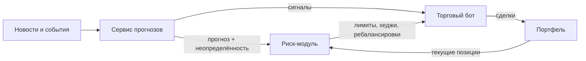

# 📊 Аналитическая платформа биржевых событий

**Управляем рисками портфеля вокруг рыночных событий — от новости до рекомендации хеджа и её исполнения**

## Идея

Тема №21 — «Разработка аналитической платформы биржевых событий».

Платформа помогает инвестору управлять рисками портфеля вокруг рыночных событий: оценивает, насколько событие может ударить по портфелю, рекомендует хеджирование и ребалансировку и исполняет эти решения.

## Как это работает

Все модули — звенья одной цепочки:

| Модуль | Отвечает на вопрос | Что делает |
|---|---|---|
| 📈 **Сервис прогнозов** | Куда пойдёт конкретная бумага? | По новости строит прогноз доходности бумаги с оценкой неопределённости |
| 🛡️ **Риск-модуль** | Насколько может пострадать портфель и что с этим делать? | Оценивает риск портфеля, задаёт лимиты, рекомендует хеджи и ребалансировки |
| 🤖 **Торговый бот** | Как исполнить решение? | Исполняет хеджи и ребалансировки, торгует по сигналам прогнозов в рамках риск-лимитов |

## 👥 Команда

- Сердюк Артём
- Черкашин Сергей
- Кротов Николай
- Холодяев Артем

**Куратор:** Алексеев Леонид

## 🗺️ План работы

| Чекпоинт | Содержание | Статус |
|---|---|:-:|
| **1** · до 06.10.2026 | Тема, команда, план работы, репозиторий | ✅ |
| **2** | Сбор данных: новости, котировки акций и фьючерсов, календарь событий; EDA | ⏳ |
| **3** | Выбор основной метрики, бейзлайны, первые модели по модулям | ⏳ |
| **4** | Эксперименты: прогнозы по новостям, модели риска и хеджирования, торговый бот | ⏳ |
| **5** | Связка модулей в цепочку, автоматический пайплайн обучения и инференса, деплой MVP | ⏳ |
| 🎓 **Защита** | Демо платформы, результаты экспериментов и выводы | ⏳ |

> План верхнеуровневый и будет уточняться по ходу работы.
