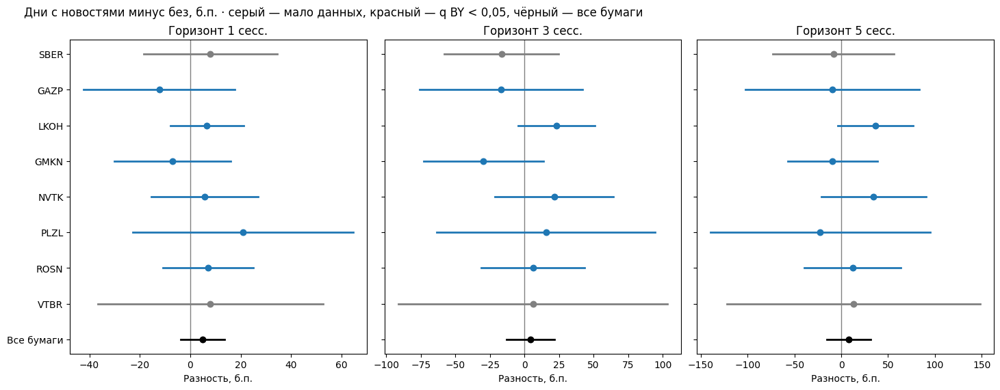
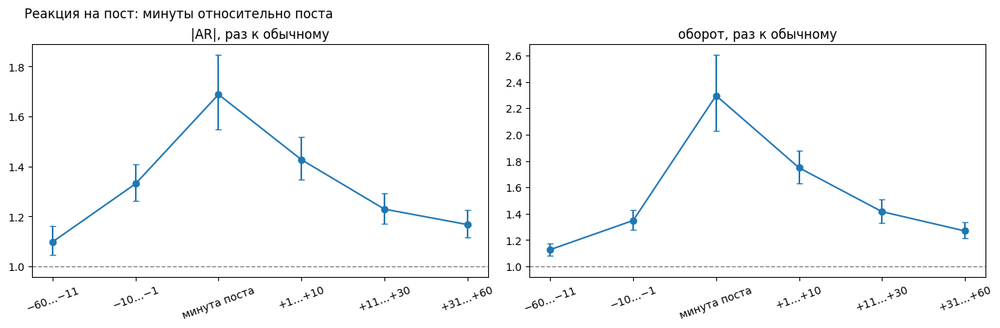
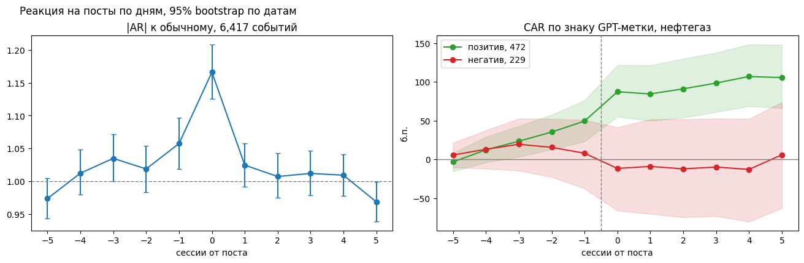
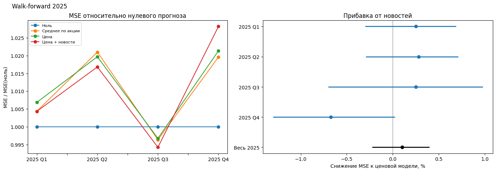

# EDA: новости и доходность акций РФ

**Вопрос:** есть ли в новостях информация о будущей доходности акций сверх цен?

**Ответ:** устойчивого сигнала нет. Новости и посты описывают движение цены, которое уже произошло.

Расчёты — [01_financial_news_eda.ipynb](01_financial_news_eda.ipynb), данные — [docs/DATA_PREPARATION.md](docs/DATA_PREPARATION.md). Разделы ниже идут в порядке ноутбука.

## Данные

- 8 акций (SBER, GAZP, LKOH, GMKN, NVTK, PLZL, ROSN, VTBR) и IMOEX, 2018–2025, минутные свечи MOEX.
- Новости (S3: ccnews, lenta), 2024–2025: 44 тыс. документов, 14,7 тыс. связей с бумагами после отбора.
- Посты MarketTwits с точным временем, 2018–2025: 6,6 тыс. событий «бумага × день».
- GPT-разметка знака постов о нефтегазе: 1,8 тыс. постов.
- Доходность — избыточная к IMOEX, по основной сессии 10:00–18:50 МСК. Дни дивидендов и сплитов исключены.

В скобках — 95% интервалы; AR — избыточная доходность.

## 02 · Качество данных

- У 22% проверенных документов ccnews дата публикации не совпадает с датой в тексте или URL; почти все — «Регнум». Они вынесены в карантин.
- Проверка по MarketTwits: похожий пост в ±1 день есть у 6,9% документов с подтверждённой датой и у 0,2% карантина.
- У 76% документов время публикации — 00:00 UTC.

## 03 · Панель
- Наблюдение — акция × сессия: 8 бумаг × 510 сессий = 4 080.
- Новость относится к первой сессии после московской даты публикации.
- Цель на 1, 3 и 5 сессий — доходность от открытия этой сессии до закрытия окна минус то же для IMOEX.
- Отбор связей новость–бумага: 53 400 → 19 529 (релевантность ≥ 0,7) → 18 061 (русский текст)
  → 18 014 (исходные флаги) → 14 690 (без карантина) → 14 688 (без повторов).

## 04 · Связь с будущей доходностью, 2024–2025

- **Наличие новостей.** Дни с новостями минус дни без них, все бумаги: +4,9 б.п. [−3,8; +13,7] на 1 сессию, +4,3 [−12,9; +21,5] на 3, +8,0 [−15,1; +31,1] на 5. По бумагам после поправки значимых 0 из 24.
- **Тональность, сессия публикации.** Положительные минус отрицательные дни: +13,6 б.п. [+3,2; +24,1].
- **Тональность, следующая сессия.** +10,9 б.п. [+0,4; +21,4] — граница значимости; знаки по бумагам разные, после поправки значимых бумаг нет.
- **Типы событий.** |AR| в дни с новостями к среднему дню бумаги: ×1,00 [0,95; 1,05]. Выделяются только дивидендные новости: ×1,37 [1,08; 1,74]. Новизна размер движения не различает.

## 05 · Реакция внутри дня: посты MarketTwits, 2018–2025

- **Размер движения, 5 072 события.** |AR| к обычному: ×1,33 за 10 минут до поста, ×1,69 в минуту поста, ×1,43 через 1–10 минут. Оборот: ×1,35, ×2,30, ×1,75.
- **Фон дня с постом:** ×1,1–1,2.
- **По годам.** В минуту поста ×1,8–3,6 с 2022 года против ×1,1–1,25 в 2018–2021.
- **Знак GPT-метки × AR, 338 событий.** До поста: +5,6 б.п. [+2,0; +9,2] за 60–11 минут и +4,1 [+0,9; +7,7] за 10–1 минуту. Первая минута после поста: +1,9 [+0,5; +3,3]. Час при входе через минуту после поста: +4,5 [−0,6; +9,4].
- **Продолжение движения до поста, все события:** +1,3 б.п. [+0,5; +2,2] к контролю.

## 06 · Реакция по дням: посты MarketTwits, 2018–2025

- **Размер движения.** |AR| к обычному: ×1,06 в день −1, ×1,17 в день поста, ×1,02 в день +1.
- **Знак GPT-метки × AR.** +18,6 б.п. [+0,3; +37,4] за 2–5 дней до поста, +31,9 [+17,6; +47,2] в день поста, +9,3 [−8,2; +24,9] через 2–5 дней.
- **Продолжение движения дня поста.** −1,3 б.п. [−5,2; +2,4] на следующий день; +12,6 [+4,8; +20,6] через 2–5 дней, без GAZP — +1,7 [−6,3; +9,6].

## 07 · Устойчивость к отбору

- В 7 из 8 вариантов оценка по всем бумагам не отличается от нуля: основной отбор, без карантина, только ccnews, только проверенные даты, задержка на сессию, отраслевой индекс вместо IMOEX, без дней изменения ключевой ставки.
- Новости с релевантностью 1,0: +9,7 б.п. [+0,8; +18,5] — граница значимости.

## 08 · Прогноз на 2025 год

- Ridge на ценовых признаках с новостными и без них; новостные — число новостей и знак тональности. Расширяющееся окно, проверка по кварталам.
- Снижение MSE от новостей: 0,10% [−0,22; +0,39] — не подтверждено.
- MSE к нулевому прогнозу: 1,01 — модели не лучше нуля.

## Ограничения

- Новости из S3 привязаны к дню, а не к минуте (Посты с markettwits имеют время и дату).
- Движение цены в вечерние и утренние торги в доходность не входит.
- Знаковая разметка есть только по нефтегазу.
- Привязка новостей к компаниям и 2% дат без независимой проверки вручную не проверялись.
- 2025 год уже исследовался: проверка диагностическая, нужен новый период.
